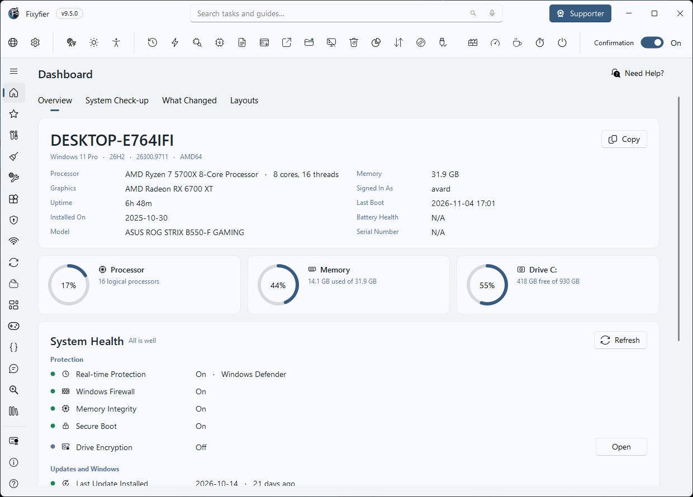
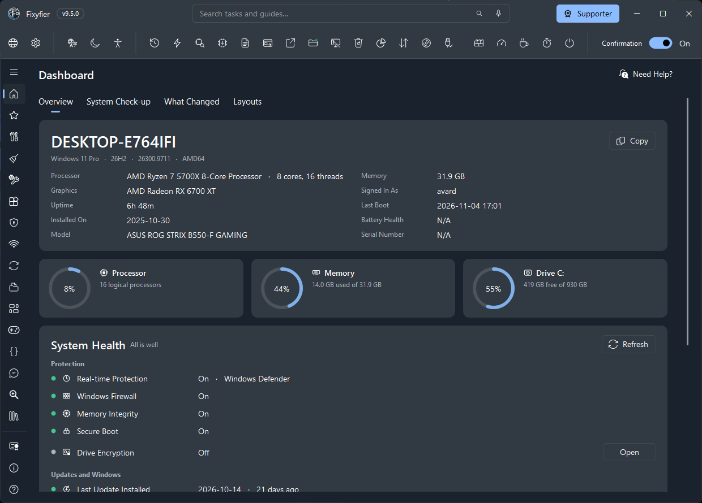

<p align="center">
  <a href="https://fixyfier.com">
    
  </a>
</p>

<h1 align="center">Fixyfier</h1>

<p align="center">
  <b>Technician-grade Windows repair &amp; maintenance — no bloat, no placebo tweaks, no noise.</b><br/>
  Every task is a documented Windows command, and you see it before it runs.
</p>

<div align="center">

  
  
  
  
  
  [](LICENSE)
  

</div>

<p align="center">
  <a href="https://apps.microsoft.com/detail/9pp0m68r9b04"><b>Microsoft Store</b></a> &nbsp;&middot;&nbsp;
  <a href="https://fixyfier.com"><b>Website</b></a> &nbsp;&middot;&nbsp;
  <a href="https://fixyfier.com/documentation/"><b>Documentation</b></a> &nbsp;&middot;&nbsp;
  <a href="https://fixyfier.com/troubleshooting/"><b>Guides</b></a> &nbsp;&middot;&nbsp;
  <a href="https://fixyfier.com/CHANGELOG.txt"><b>What's New</b></a> &nbsp;&middot;&nbsp;
  <a href="https://fixyfier.com/#support"><b>Support</b></a>
</p>

<p align="center">
  <picture>
    <source media="(prefers-color-scheme: dark)" srcset="assets/img/fixyfier-dark-mode-interface.png">
    
  </picture>
</p>

---

## Why Fixyfier

Most "optimization" tools are bloated, noisy, or full of tweaks that do nothing.
Fixyfier collects the repair tools Windows already ships with — DISM, SFC, CHKDSK, the
built-in troubleshooters, the network stack commands, winget, Windows Update and dozens of
buried settings — puts them one click away, and adds the answers Windows keeps in its own
records: why the PC is slow, what crashed, what changed, what got worse, where the space went.

It is a convenience layer, not a magic fix. **Nothing happens that you could not do
yourself from an elevated terminal**, and you are shown the command line first.

<table>
<tr>
<td width="25%" align="center"><b>No ads</b></td>
<td width="25%" align="center"><b>No account</b></td>
<td width="25%" align="center"><b>No telemetry</b></td>
<td width="25%" align="center"><b>No analytics</b></td>
</tr>
</table>

Settings, routines and your change history live in one file, `settings.json` in
`%LOCALAPPDATA%\Fixyfier`, on your PC only, with a backup copy beside it. No log files are
kept unless you turn on the Log yourself. Fixyfier goes online only when a task needs it:
app installs and updates, driver updates, the extra cleaning rules, network tests, the speed
test (only when you press Start), guide links, the update check and the Microsoft Store
purchase check. **Offline Mode** stops all of it with one switch, and **What Has Fixyfier
Done?** lists every time it went online in this session, and why.

---

## What it does

Close to **300 tasks, switches and answers** across **sixteen screens**, grouped by what you are trying to achieve.

<table>
<tr>
<td width="33%" valign="top">

### 🖥️ Dashboard
What the machine is — with its serial number, model and battery health — live gauges and a **System Health** card in four groups. Plus a **34-check System Check-up**, **What Changed** in the last 30 days with Undo, and **Layouts**: desktop icons and windows saved to scale across every screen and virtual desktop, restored with a keyboard shortcut or by themselves.

</td>
<td width="33%" valign="top">

### ⭐ Favorites &amp; Routines
Star any task to pin it, run the first nine with `Ctrl+1`–`Ctrl+9`, and chain tasks into named routines — run with one click, on a schedule, or from the notification area. Save a routine as a **fix file** to send to someone else's PC.

</td>
<td width="33%" valign="top">

### 🔧 Fix &amp; Repair
One Fix pass with seven steps, DISM, SFC, CHKDSK, the icon and search caches, **Fix Hardware Detection Issues** (why a drive or USB device stays hidden), undoing other tools' damage, and every built-in troubleshooter — grouped by what is broken.

</td>
</tr>
<tr>
<td valign="top">

### 🧹 Cleanup &amp; Optimize
Temp files, the Recycle Bin, Teams and Outlook caches, `Windows.old`, restore points, Storage Sense and community cleaning rules that remember what you chose — always with a dry run first.

</td>
<td valign="top">

### 🛠️ System Tools
Specifications and drive health, Windows Features, **Explorer &amp; Taskbar** switches, **Set Services to Manual** with Put Back, a PC report, moving to a new PC, and **Windows Image Creator** — a clean Windows ISO without the extras you untick.

</td>
<td valign="top">

### 🪟 Windows Tools
**33** Windows consoles and pages one click away — Event Viewer, Device Manager, Registry Editor, Services, Task Manager — and the classic Control Panel windows people still look for, from System Properties to Credential Manager.

</td>
</tr>
<tr>
<td valign="top">

### 🔒 Security &amp; Privacy
Defender scans, the firewall, Smart App Control and User Account Control, **50+** advertising, suggestion and diagnostic-data switches, **AI Features** (Recall, Click to Do, Paint and Notepad), **Edge Debloat** with Microsoft's own policies, and **Offline Mode**.

</td>
<td valign="top">

### 🌐 Network &amp; Connectivity
Your IP addresses, Wi-Fi details, sharing Wi-Fi with a QR code, ping, traceroute, active connections, DNS flush, an IPv6 setting, and TCP/IP, Winsock and full stack resets.

</td>
<td valign="top">

### 🔄 Updates
**Install Apps** (about eighty popular programs plus winget's whole catalogue, with app lists to export and import), app updates, **Update Drivers** from Windows Update — never an older one — and **Windows Update Settings**: pause, delay or stay on this version.

</td>
</tr>
<tr>
<td valign="top">

### 📁 Files &amp; Folders
Force-delete, unlock, lock, hide, repair permissions, get back an older version, check a file's fingerprint, and **Eject a Drive** that names the program holding it — most of them also in File Explorer's right-click menu.

</td>
<td valign="top">

### 📦 Installed Apps
Every app in one fast list with sizes, multi-select uninstall, Reset and Repair, Startup Apps and programs' scheduled tasks A to Z, and a switch for each of **31** preinstalled apps.

</td>
<td valign="top">

### 🎮 Gaming
**Game Session** sets the PC up for playing in one click — power plan, updates paused, Game Mode, background programs closed — and **End Game Session** puts back exactly what it changed. With the gaming switches that make a measurable difference, and no fake "FPS boosts".

</td>
</tr>
<tr>
<td valign="top">

### ❓ Answers
**34** questions about this PC as it is now, answered from Windows' own records, many with charts: why there is no sound, **Why Does My Game Stutter?**, **How Fast Is My Internet?**, **Who Is on My Network?**, **Find Where the Connection Breaks**, and **What Is Taking Up the Space?** with the whole drive drawn as a map.

</td>
<td valign="top">

### 🕵️ PC Detective
**32** investigations into what really happened: **What Got Worse, and Why?**, **Did It Help?**, **Rewind to the Day It Worked**, **Catch It in the Act**, **Hand It Over Sealed**, **Watch an Install**, **How Used Is This PC?**, a monthly **PC Health Letter** — and *I Think I Was Scammed*.

</td>
<td valign="top">

### 📜 Scripts &amp; MyTools
Generate a cleanup batch file, build your own, or run your `.bat`, `.cmd`, `.ps1` and `.vbs` files with the rights Fixyfier already has.

</td>
</tr>
<tr>
<td colspan="3" valign="top" align="center">

### 📚 Troubleshooting Guides
All **72** fixyfier.com guides in the app, each section with a short moving picture and buttons that check this PC first — and a search that understands symptoms: type or say *no sound* and it finds the audio repair.

</td>
</tr>
</table>

---

## How it behaves

> These are the rules the app is built on, not marketing lines.

- **Every command is shown before it runs.** Advanced tasks print the exact command line.
- **There is always a way back.** An advanced task asks Windows for a restore point first, and Your Changes can undo what Fixyfier changed.
- **The right order, suggested.** *Run This First* offers what a task works best after — the image repair before system files, fresh definitions before a scan — and the lighter fix before a full network or update reset.
- **Try before you keep.** Any switch can be turned on *on trial*: next time Fixyfier opens, it asks whether to keep it, with how the PC has done since.
- **Unknown is a real answer.** Anything Fixyfier could not read says so, rather than showing green or zero.
- **Deletions preview first.** Cleanup tasks offer a dry run that lists what would go, without removing anything.
- **A long run can be stopped.** Output is live, and Stop ends the run rather than the current step.
- **What Windows needs stays put.** Core processes are never ended, and services Windows needs to start are never stopped, disabled or set to Manual.
- **Your files are yours.** Fixyfier never reads, changes or vouches for the scripts in your MyTools folder.

---

## Finding your way

- **Search, typed or spoken.** Type a task's name or what is wrong — with *"Did you mean…?"* for typos — or click the microphone and say it. Voice search uses Windows' own offline speech recognition.
- **Need Help?** (`F1` or `Ctrl+/`) explains the screen you are on in two plain sentences and suggests where to start when something is wrong.
- **Help** has 13 topics, each with a short moving picture drawn in your language and theme, and *Show Me* lights up the real control in the window.
- **The top bar** keeps the everyday tools on every screen — restore point, Quick Actions, Update Drivers, Open, Run…, Power and more — and **Customize** shows or hides any icon or screen.
- **Start with Windows**, minimized to the notification area, so Eject a Drive, layout shortcuts and the low-space notices work from the moment you sign in.

---

## Accessibility

Fixyfier works with **Narrator, NVDA and other screen readers**: every card says its name, its
state and what it does, every icon button is named, and finished runs are announced.

The **Accessibility** panel in the top bar has High Contrast, status colors for red-green or
blue-yellow color blindness (with a shape on every status dot), an easy-to-read font, wider
text spacing, a reading guide, Reduce Motion, a stronger focus ring, **Text size** up to 200%,
and **Read Aloud**, which reads what you point at in the app's own language with the voices
Windows has installed. Windows' own contrast themes are followed too.

---

## Themes

Light and dark, switchable from the top bar, and the whole app follows.

<table>
  <tr>
    <td align="center">
      <br>
      <sub><b>Light Theme</b></sub>
    </td>
    <td align="center">
      <br>
      <sub><b>Dark Theme</b></sub>
    </td>
  </tr>
</table>

---

## Languages

Fixyfier ships in **44 languages**, chosen from a grid in the top bar and applied immediately,
with Arabic, Hebrew and Persian laid out right to left.

<details>
<summary><b>See the full list</b></summary>

<br/>

Albanian &middot; Arabic &middot; Bengali &middot; Bulgarian &middot; Chinese (Simplified) &middot;
Chinese (Traditional) &middot; Croatian &middot; Czech &middot; Danish &middot; Dutch &middot;
English &middot; Estonian &middot; Filipino &middot; Finnish &middot; French &middot; German &middot;
Greek &middot; Hebrew &middot; Hindi &middot; Hungarian &middot; Indonesian &middot; Italian &middot;
Japanese &middot; Korean &middot; Latvian &middot; Lithuanian &middot; Norwegian &middot; Persian &middot;
Polish &middot; Portuguese (Brazil) &middot; Portuguese (Portugal) &middot; Romanian &middot; Russian &middot;
Serbian &middot; Slovak &middot; Slovenian &middot; Spanish &middot; Spanish (Latin America) &middot;
Swahili &middot; Swedish &middot; Thai &middot; Turkish &middot; Ukrainian &middot; Vietnamese

</details>

---

## Install

Get the signed, always-current build from the Microsoft Store.

<p>
  <a href="https://apps.microsoft.com/detail/9pp0m68r9b04?referrer=appbadge&amp;mode=direct&amp;cid=github_official" target="_blank">
    
  </a>
</p>

**WinGet**

```powershell
winget install --id 9pp0m68r9b04 --source msstore
```

Fixyfier runs as administrator, because most of what it does requires it.

---

## MyTools

Drop a `.bat`, `.cmd`, `.ps1` or `.vbs` file into `Documents\Fixyfier\MyTools` and it appears
as a card straight away — no restart, no right-click, no execution-policy detour. Fixyfier is
already elevated, so your script runs elevated.

The first **three runs are free**. After that it is a one-time unlock in the Microsoft Store:
no subscription, no tiers, and every other feature of Fixyfier works exactly the same either way.

---

<p align="center">
  <b>Fixyfier is free and maintained independently.</b><br/>
  If it saves you time, you can support it here:<br/><br/>
  ❤️ <a href="https://www.paypal.com/donate/?hosted_button_id=5ZA38NSJHMWHJ"><b>Support Fixyfier</b></a>
</p>

<p align="center">
  <sub><a href="https://fixyfier.com/documentation/">Documentation</a> &middot;
  <a href="https://fixyfier.com/troubleshooting/">Troubleshooting Guides</a> &middot;
  <a href="https://fixyfier.com/CHANGELOG.txt">What's New</a> &middot;
  <a href="https://fixyfier.com">fixyfier.com</a></sub>
</p>
